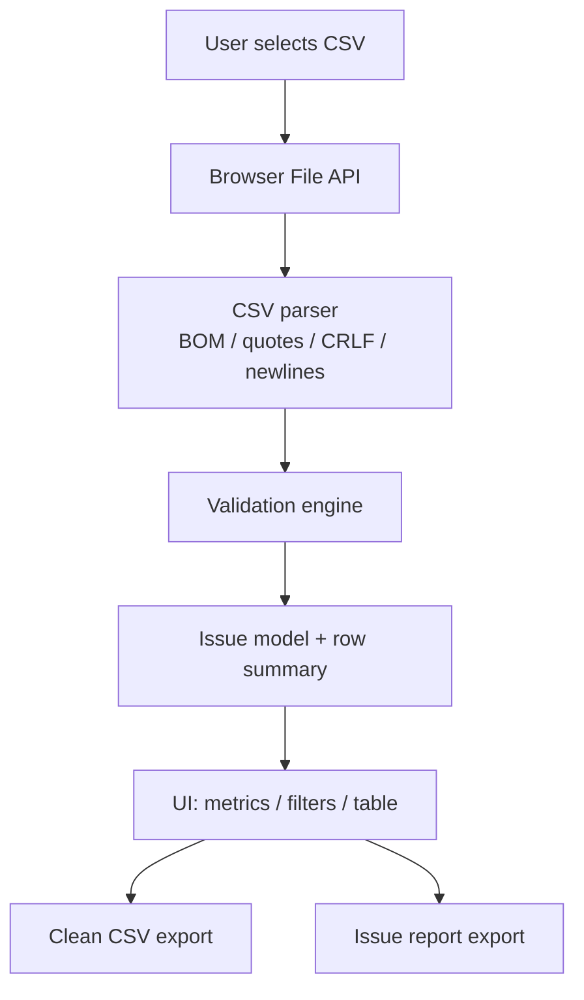

# DataCheck architecture

DataCheck is a static browser application. A small local static server serves the files; it does not receive the CSV contents. Parsing, validation, filtering, and export happen in the browser tab.

## Responsibilities

- `index.html`: semantic layout, controls, accessible labels, and result regions.
- `styles.css`: responsive interface and visual states.
- `src/csv.js`: deterministic quote-aware parser and CSV serializer.
- `src/validator.js`: stateless validation rules, summaries, and row filtering.
- `src/app.js`: browser state, event handling, rendering, and downloadable exports.
- `tests/`: Node built-in test suite for parser and validation logic.

## Data flow

1. A file is selected with the browser File API.
2. The app applies size/type limits before reading text.
3. `parseCSV` converts CSV text to a two-dimensional array.
4. `validateRows` checks the header and records; it returns headers, records, issues, file-level issues, and summary metrics.
5. The UI renders results and filters records without changing source values.
6. Export functions serialize clean records and issue rows into separate downloadable CSV files.

## Key decisions

- No application backend: reduces deployment scope and avoids sending CSV contents to a server.
- No runtime dependencies: parser and validator use browser/JavaScript primitives.
- Separate parser, validator, and UI: makes data rules testable without a browser DOM.
- Conservative exports: rows with any row-level finding are excluded from the clean export; issue detail is preserved separately.
